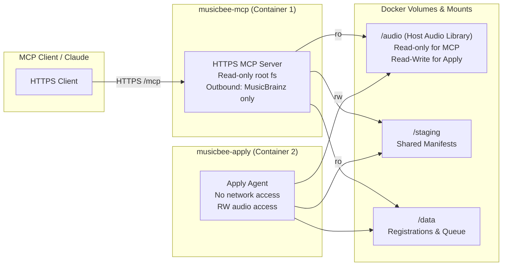

# Docker Hosting and Two-Container Sandboxing

MusicBee Tagger MCP supports a secure, least-privilege Docker Compose deployment utilizing a two-container sandboxing model. This architecture isolates the network-facing MCP server from the physical audio file modification agent.

## Architecture Overview



### 1. `musicbee-mcp` (Container 1)
- **Role**: Exposes an HTTPS-secured Model Context Protocol (MCP) server on port 8443.
- **Security Posture**:
  - Read-only root file system (`read_only: true`).
  - `/audio` directory mounted **read-only** (`:ro`) — enforces that the MCP server and AI agent can **never** modify physical audio files.
  - `/staging` (writable) for JSON stage manifests produced by the agent.
  - `/data` (writable) for persistent SQLite queue, job state, and token registrations.
  - Network access restricted to outbound calls required for MusicBrainz and ACRCloud APIs.

### 2. `musicbee-apply` (Container 2)
- **Role**: Executes physical audio tag modifications based on review-approved stage manifests.
- **Security Posture**:
  - **No outbound network access** (`musicbee-internal` network without external gateway).
  - `/audio` directory mounted **read-write** (`:rw`) — the **only** container permitted to write to the library.
  - `/staging` mounted **read-only** (`:ro`) to read approved change manifests.

---

## Configuration & Deployment

1. Copy the environment template:
   ```sh
   cp .env.example .env
   ```
2. Configure `.env` to specify your local audio library path:
   ```env
   MUSICBEE_AUDIO_DIR=/path/to/your/music/library
   MCP_HTTPS_PORT=8443
   SECRET_COMMAND_TOKEN=your-secure-token
   ```
3. Start the containers:
   ```sh
   docker compose up -d
   ```
4. Connect your MCP client (such as Claude Desktop) to `https://localhost:8443/mcp`.
5. To apply review-approved staged changes:
   ```sh
   docker compose exec musicbee-apply musicbee-tagger-apply --all
   ```

---

## Path Translation

To bridge host filesystem paths with secure container bind mounts (e.g., mapping host library `S:\Audio\Music\MusicBee\Main` to container path `/audio`), the file registry uses virtual container path translation (`translate_audio_path`). This guarantees that token registration and staging operate correctly across host and container boundaries without exposing unmapped host paths to untrusted contexts.
