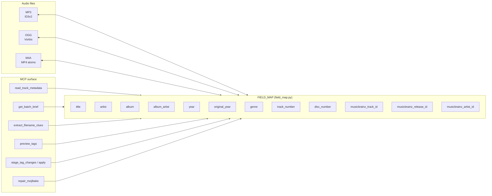

# Field map: exposed tags

The field map is the single source of truth for every tag the tool reads and
writes. Each canonical field declares its **read keys** (probed in order per
format) and its **write targets** (ID3 frame, Vorbis comment key, MP4 atom).

Current surface: **12 canonical fields**, **53 format-native read keys**,
write support on all three formats (MP3/ID3, OGG/Vorbis, MP4/M4A).

## Per-field mapping

| Canonical field | Read keys (order matters) | ID3 | Vorbis | MP4 |
|---|---|---|---|---|
| title | title, TIT2, ©nam, TITLE | TIT2 | TITLE | ©nam |
| artist | artist, TPE1, ©ART, ARTIST | TPE1 | ARTIST | ©ART |
| album | album, TALB, ©alb, ALBUM | TALB | ALBUM | ©alb |
| album_artist | albumartist, album artist, TPE2, aART, ALBUMARTIST | TPE2 | ALBUMARTIST | aART |
| year | date, year, TDRC, TYER, ©day, DATE, YEAR | TDRC | DATE | ©day |
| original_year | originaldate, originalyear, TDOR, ORIGINALDATE, ORIGINALYEAR | TDOR | ORIGINALDATE | ----:…:ORIGINALDATE |
| genre | genre, TCON, ©gen, GENRE | TCON | GENRE | ©gen |
| track_number | tracknumber, TRCK, trkn, TRACKNUMBER | TRCK | TRACKNUMBER | trkn (pair) |
| disc_number | discnumber, TPOS, disk, DISCNUMBER | TPOS | DISCNUMBER | disk (pair) |
| musicbrainz_track_id | ----:…:MusicBrainz Track Id, musicbrainz_trackid, UFID:http://musicbrainz.org, MUSICBRAINZ_TRACKID | UFID (payload) | MUSICBRAINZ_TRACKID | ----:…:MusicBrainz Track Id |
| musicbrainz_release_id | ----:…:MusicBrainz Album Id, musicbrainz_albumid, TXXX:MusicBrainz Album Id, MUSICBRAINZ_ALBUMID | TXXX | MUSICBRAINZ_ALBUMID | ----:…:MusicBrainz Album Id |
| musicbrainz_artist_id | ----:…:MusicBrainz Artist Id, musicbrainz_artistid, TXXX:MusicBrainz Artist Id, MUSICBRAINZ_ARTISTID | TXXX | MUSICBRAINZ_ARTISTID | ----:…:MusicBrainz Artist Id |

Notes:

- Reading strips invisible Unicode format characters (zero-width, bidi marks)
  from values — see the reader, not the map.
- MP4 `trkn`/`disk` are `(number, total)` pairs; `normalize_track_number`
  parses `3/12`-style text everywhere else.
- MP3 MusicBrainz IDs use non-text frames: `UFID:http://musicbrainz.org` for
  track IDs, `TXXX` with the given description for release/artist IDs.

## Planned additions (issue #18)

- `artist_sort` (TSO2 / ARTISTSORT / ©soa), `title_sort` (TSOT / TITLESORT /
  ©son), `album_sort` (TSOA / ALBUMSORT / ©soa)
- `lastfm_title`, `lastfm_artist`, `lastfm_url` as custom TXXX / Vorbis /
  freeform-MP4 fields — pinning the verified most-popular scrobble form

## Out of scope for tags

Fingerprint service IDs (ACRcloud/AcoustID) belong in the staging manifest
sidecar, not in audio tags.
